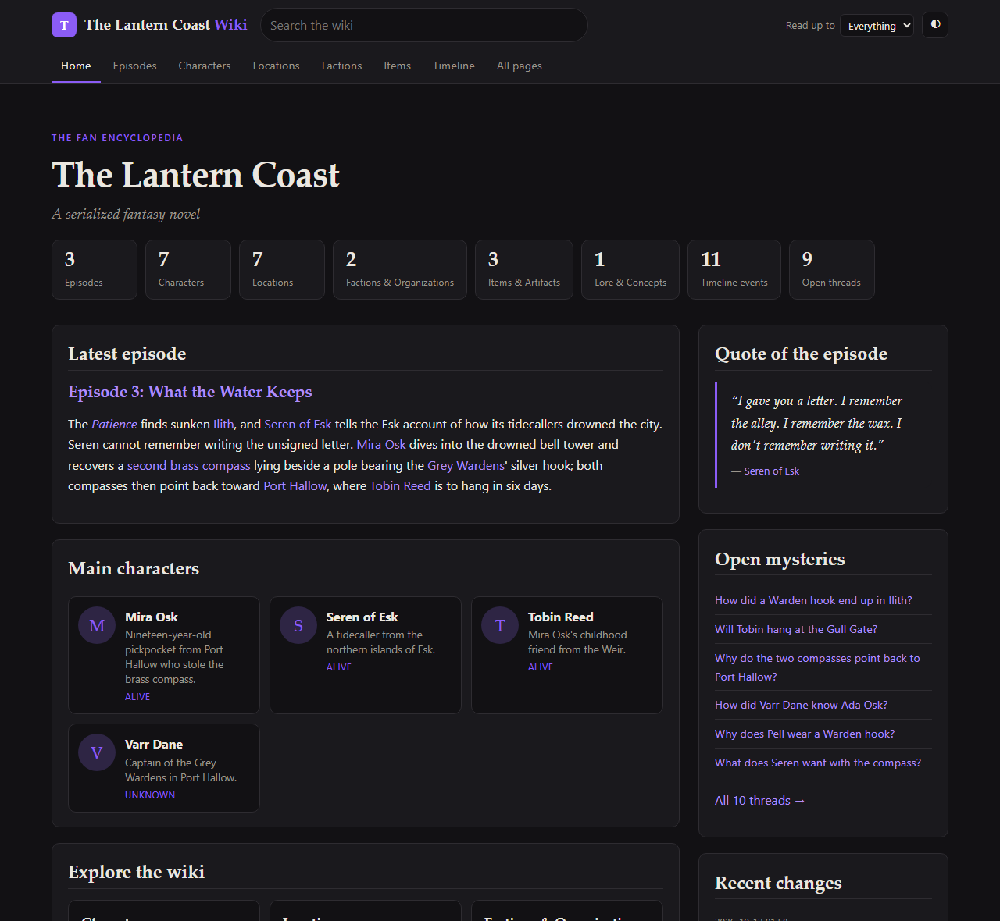
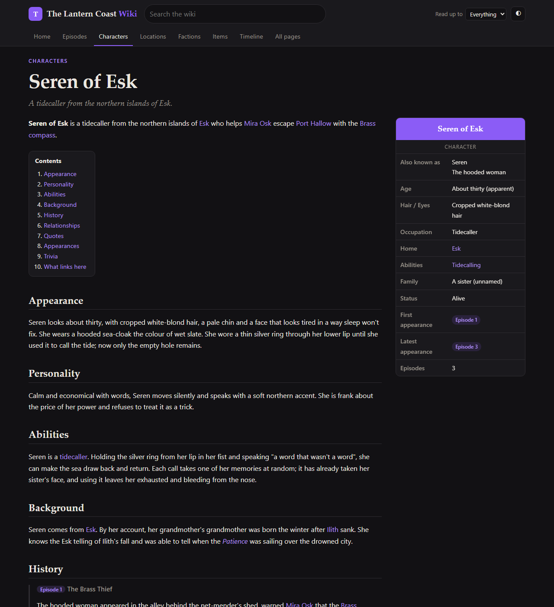
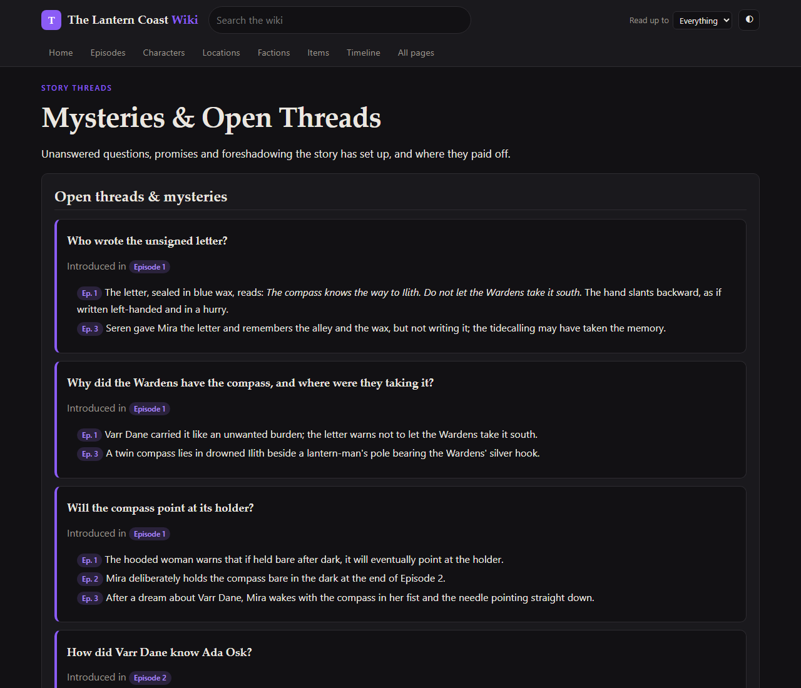
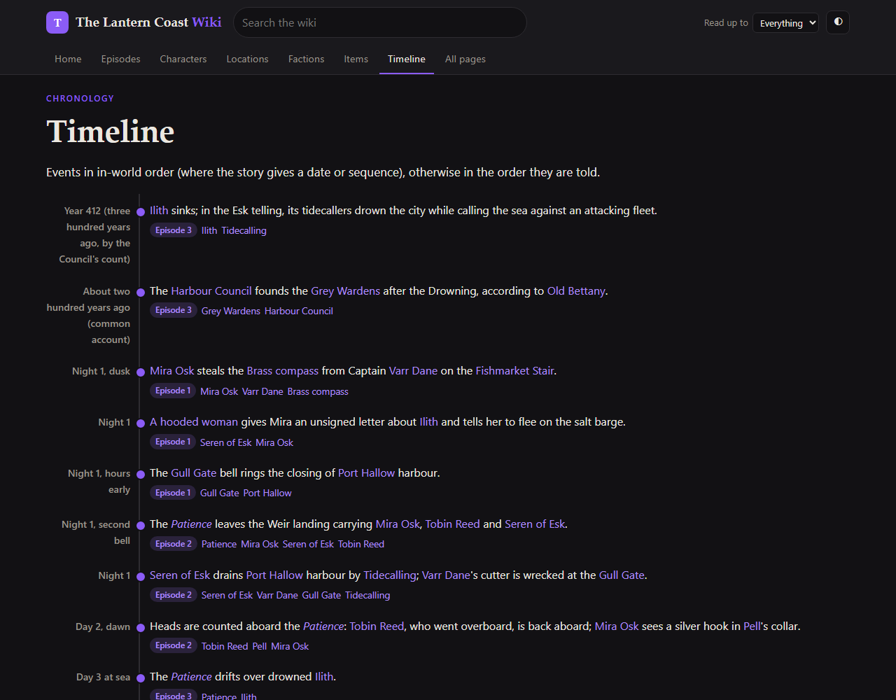
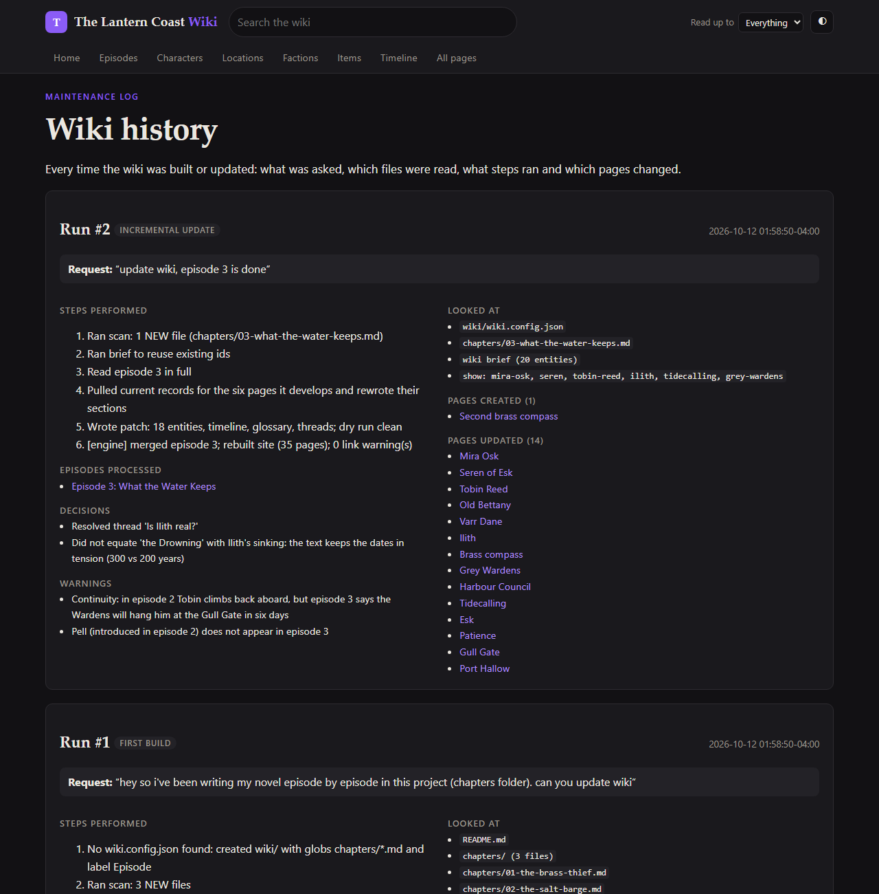

# novel-wiki: a living fan wiki for the novel you're writing

[](https://github.com/0msm0/novel-wiki-skill/actions/workflows/tests.yml)
[](https://0msm0.github.io/novel-wiki-skill/)
[](https://github.com/0msm0/novel-wiki-skill/releases/latest)
[](LICENSE)

A [Claude skill](https://code.claude.com/docs/en/skills) for anyone writing a novel, web serial or episodic story with Claude Code.
After each new episode, say **"update wiki"**. Claude reads what changed and updates a
fandom-style wiki, the kind of thing Wookieepedia, Tolkien Gateway or the Naruto wiki do for their
worlds. You get a static HTML site you can open locally or publish anywhere.



## What you get

Each run produces or updates `wiki/site/`, a self-contained website:

| | |
|---|---|
| **Articles** for characters, locations, factions, species, items, lore/magic systems and events | infobox, lead, table of contents, Appearance / Personality / Abilities / Background, per-episode **History**, relationships, quotes, appearances, trivia, *What links here* |
| **Episode guide** | summary, full synopsis, point of view, featured cast, debuts, prev/next |
| **Timeline** | in-world chronology (handles flashbacks) |
| **Mysteries & open threads** | every question the story sets up, each clue by episode, marked resolved when it pays off |
| **Glossary** | in-world terms and titles |
| **Spoiler filter** | readers pick "I've read up to Episode N" and later content hides |
| **Search, dark/light mode, phone layout** | works offline from `file://` and on any static host |
| **Wiki history** | a log of every run: the request, steps performed, files read, decisions, warnings, pages created/updated/removed (`site/history.html` and `wiki/WIKI-HISTORY.md`) |

<p>




</p>

**[Browse the live demo →](https://0msm0.github.io/novel-wiki-skill/)**, the wiki generated for a 3-episode
test novel included in this repo ([`examples/lantern-coast/`](examples/lantern-coast/)). Try the search, and the
"Read up to" spoiler filter in the top bar.

## Install

The skill is the `novel-wiki/` folder. It needs Python 3.8+ (standard library only).

**Claude Code: all your projects**
```bash
git clone https://github.com/0msm0/novel-wiki-skill
cp -r novel-wiki-skill/novel-wiki ~/.claude/skills/
```
On Windows (PowerShell): `Copy-Item -Recurse novel-wiki-skill\novel-wiki $HOME\.claude\skills\`

**Claude Code: one project, shared with collaborators**: copy it to `<project>/.claude/skills/novel-wiki/` and commit it.

**Claude.ai**: download `novel-wiki.zip` from [the latest release](https://github.com/0msm0/novel-wiki-skill/releases/latest) (or `dist/`), then go to *Settings → Capabilities → Skills → Upload skill*. Code execution must be enabled. You'll be working with uploaded files there, so Claude Code is the better fit for a manuscript that lives on disk.

**Claude API / Agent SDK**: upload the folder with the `/v1/skills` endpoint and attach it via `container.skills` (requires the code-execution tool).

Check that it loaded: in Claude Code, type `/novel-wiki`, or ask *"When would you use the novel-wiki skill?"*.

## Use

Write your story as one file per episode or chapter (Markdown or text), in a folder such as `chapters/`,
`episodes/` or `manuscript/`. Then just talk to Claude:

| You say | What happens |
|---|---|
| `update wiki` | First time: finds your chapter files, creates `wiki/`, reads every episode and builds the site. After that: processes only **new or revised** episodes. |
| `add episode 12 to the wiki` | Processes just that episode. |
| `I rewrote chapter 4, sync the wiki` | Rolls back everything chapter 4 contributed and re-applies the new version, so cut characters disappear. **Flags any contradictions** with later chapters instead of hiding them. |
| `on the wiki, Kael's sword is Dawnbreaker, and make Lira a major character` | Applies an editorial correction. Corrections are **sticky**: re-processing a chapter can't silently undo them. Claude also tells you if the manuscript still says otherwise. |
| `make the wiki teal` / `use Chapter instead of Episode` | Edits `wiki/wiki.config.json` or `wiki/custom.css` and rebuilds. |

Claude ends each run with a short report: episodes processed, pages created and updated, mysteries opened
or resolved, and anything worth your attention (continuity slips, characters who vanished, dates that don't add up).

**Publishing:** `wiki/site/` is plain static HTML with relative links. Drag it into
[Netlify Drop](https://app.netlify.com/drop), push it to a `gh-pages` branch, or upload it to any web host.
`wiki/data/` holds the database and audit trail; keep it in your repo but you don't need to publish it.

### What it creates in your project

```
your-novel/
├── chapters/                 your manuscript (read-only to the skill)
└── wiki/
    ├── wiki.config.json      title, chapter file globs, "Episode"/"Chapter", accent colour
    ├── WIKI-HISTORY.md       human-readable log of every run
    ├── custom.css            optional theme overrides
    ├── data/
    │   ├── wiki.json         the wiki database
    │   ├── history.json      run log
    │   └── patches/          what was extracted from each episode (audit trail)
    └── site/                 the publishable website
```

## Results

Tested with Anthropic's [skill-creator](https://github.com/anthropics/skills) method. Each scenario was run
in a fresh session **with** the skill and **without** it (same prompt, Claude Opus), then graded on
objective checks: the right pages exist, no duplicates, facts match the text, the revision was applied,
history was recorded, and the manuscript was untouched.

| Scenario | With skill | Without skill |
|---|---|---|
| First build from 2 episodes ("update wiki") | 11/11 checks, 214s | 11/11, 399s |
| New episode + rewritten earlier episode | 8/8, 240s | 8/8, 543s |
| Author correction (age, importance) | 5/5, 68s | 5/5, 102s |
| **Mean** | **100%, 174s, 81k tokens** | 100%, 348s, 110k tokens |

Without the skill, Claude Opus can hand-build a decent wiki, but it invents a different structure every
time and has to write its own generator on every run. In the revision test it had to rebuild its renderer
first. With the skill, runs take about **half the time** and **~27% fewer tokens**, and every author gets
the same structure and safeguards: revision rollback, sticky corrections, a spoiler filter, a mysteries
tracker and a complete history.

Both configurations caught the planted continuity error (a character who escapes in the revised
episode 2 but is still due to hang in episode 3). The skill also surfaced two unplanted ones.

**Triggering** (18 realistic prompts, 2 runs each, fresh `claude -p` sessions with the skill installed):
**18/18 correct, 36/36 sessions.** All 9 should-trigger prompts activated it every time, including
"sync the story bible site with the new chapter pls" and "on the wiki, Kael's sword should be called Dawnbreaker".
All 9 near-misses left it alone every time: a code project's docs wiki, a Wikipedia lookup, writing
a new chapter, beta-reader feedback, a back-cover blurb, a chapter summary, MediaWiki setup, mkdocs, and a
relationship diagram for someone else's book.

The eval suite is in [`tests/evals/`](tests/evals/).

## How it works

```
 you: "update wiki"
   │
   ▼
 Claude (SKILL.md workflow)                       scripts/wiki.py (deterministic engine)
 ─────────────────────────                        ──────────────────────────────────────
 1. find wiki/ or create it          ──init──▶   config + empty database
 2. what changed?                    ──scan──▶   NEW / CHANGED / OK / MISSING per file
 3. what do we already know?         ──brief─▶   every page id, alias, open thread
 4. read each episode in full,
    write a JSON patch of what it
    establishes (canon only)         ──apply─▶   merge · roll back revisions · keep corrections
                                                  · cross-links & backlinks · rebuild site
                                                  · append run to history
 5. report back                      ──check─▶   broken links, likely duplicates
```

The split matters. Reading fiction and making editorial calls (is "the hooded woman" the same person as
Seren? is this a twist or a continuity slip?) needs Claude's judgement. Merging, rollback, link integrity
and HTML need to come out the same every time, so they live in a tested script.

Skill structure (progressive disclosure: only `SKILL.md` loads when triggered; references are read on demand):

```
novel-wiki/
├── SKILL.md                     workflow, rules, troubleshooting (~200 lines)
├── scripts/wiki.py              engine: init, scan, brief, show, apply, forget, build, log, check
├── references/patch-format.md   patch schema + example (read when writing patches)
├── references/wiki-style.md     fan-wiki conventions: what gets a page, article templates, canon rules
└── assets/style.css, app.js     site theme, search, spoiler filter
```

## Safety and privacy

- Reads your manuscript; **never edits it**. Writes only inside `wiki/`.
- No network access, no dependencies, no telemetry. The site has no external requests.
- Canon only: the wiki records what the text says and puts open questions in the mysteries tracker instead of guessing.
- Each run backs up the database (`wiki.json.bak`) and archives every patch, so changes are auditable and reversible.

## Troubleshooting

| Symptom | Fix |
|---|---|
| Skill doesn't activate | Say "update the novel wiki", or type `/novel-wiki`. Check that the folder is at `~/.claude/skills/novel-wiki/SKILL.md`. |
| "No episode files matched" | Edit `episode_globs` in `wiki/wiki.config.json` (relative to the project root; `**` works). |
| `python` not found | Install Python 3.8+; on macOS/Linux the skill falls back to `python3`. |
| A fact on the wiki is wrong | Tell Claude: "on the wiki, X should be Y". Corrections stick. |
| A chapter was deleted or renamed | `scan` shows it as MISSING; Claude asks before removing it from the wiki. |

## Development

```bash
python -m unittest discover tests -v      # engine regression tests (14 tests, ~10s)
```
CI runs the tests on Linux, macOS and Windows (Python 3.8 and 3.12) and redeploys the demo site on every push.
`tests/evals/` holds the behavioural eval prompts, the grader, the trigger test and the fixture novel.
Contributions are welcome: keep `SKILL.md` lean, put detail in `references/`, and add a test for any engine change.

## License

[MIT](LICENSE)
